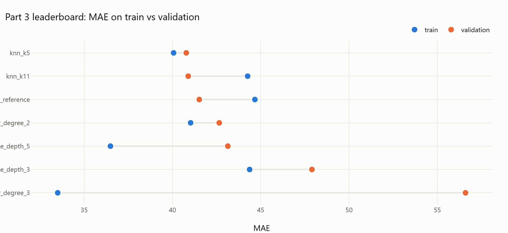
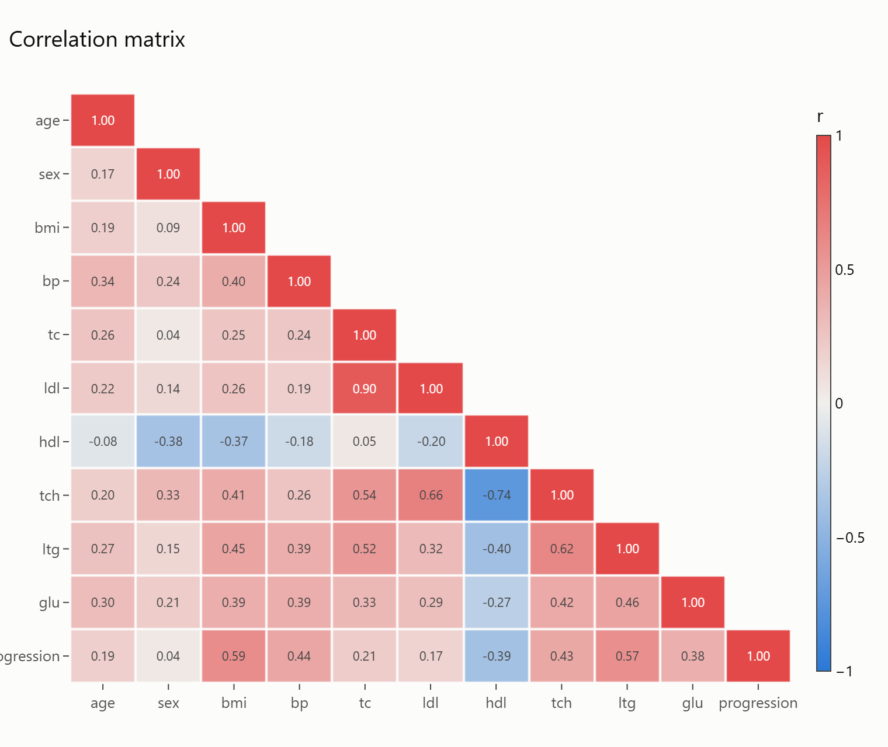
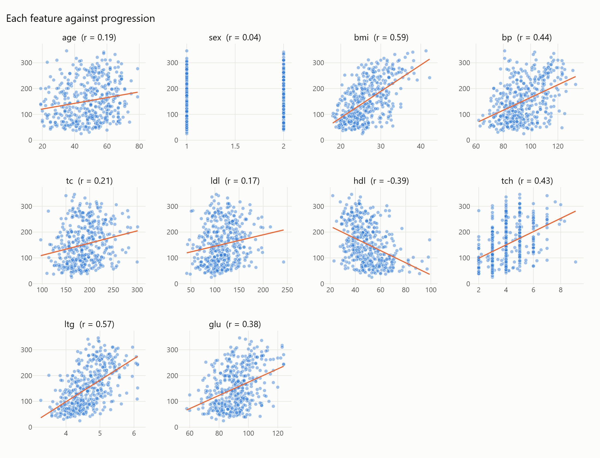
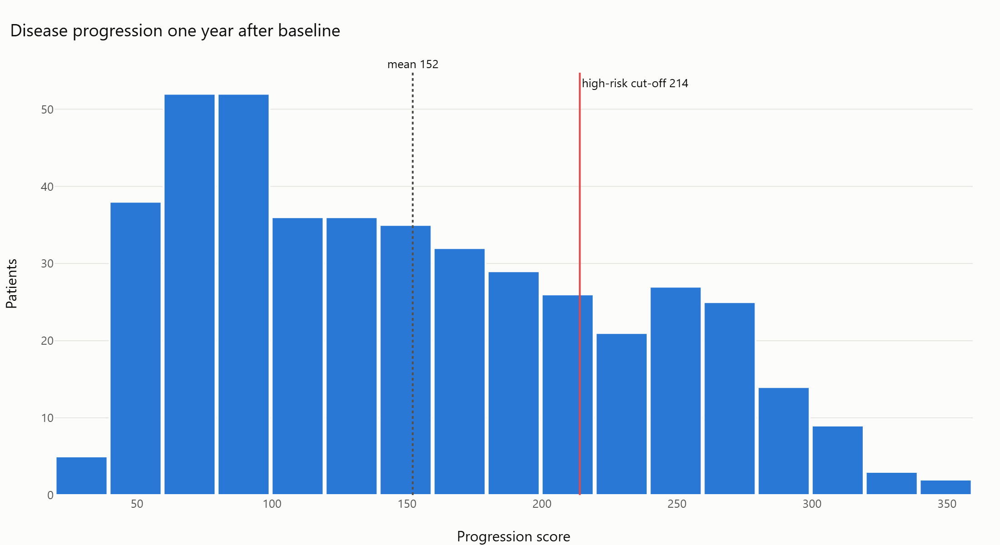
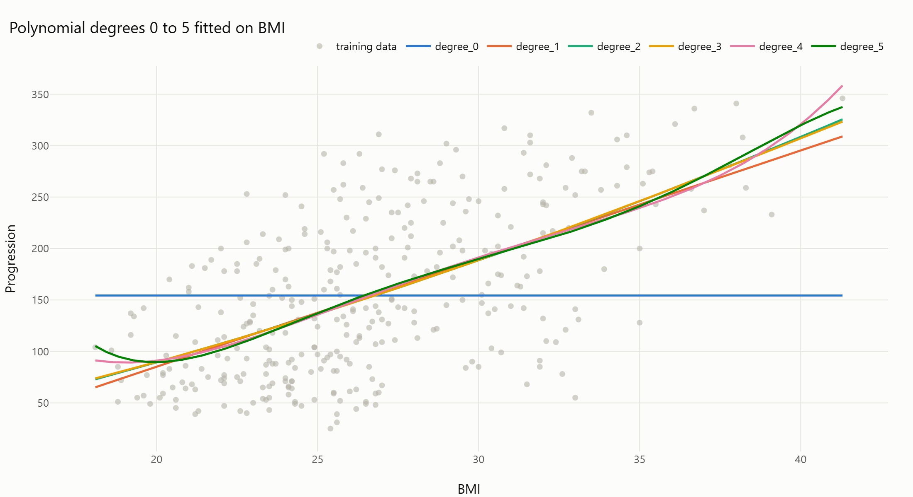
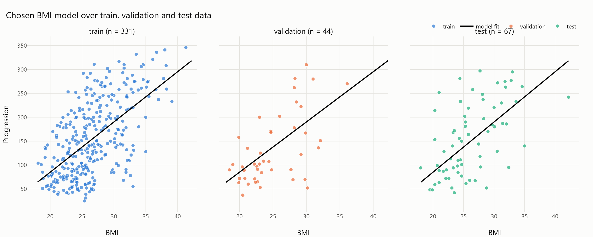
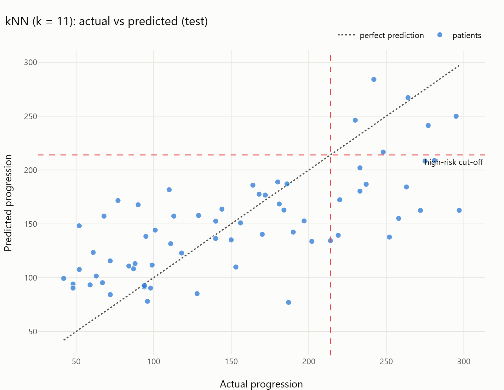
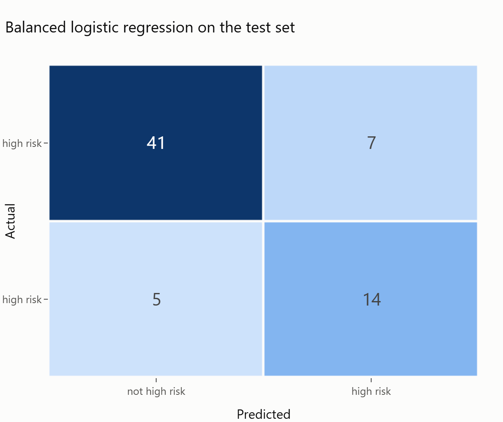
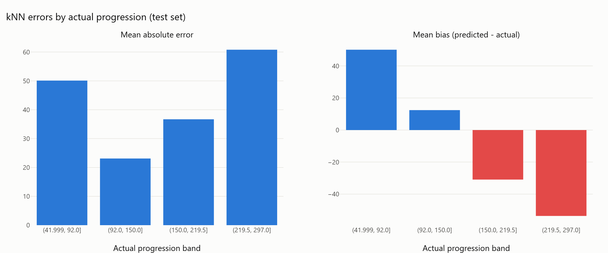

# Diabetes Progression Screening

Predicting one-year disease progression from baseline clinical measurements, and flagging high-risk patients for follow-up.


**Sultan Akinola Atanda** · CSCN8010 Foundations of Machine Learning · Conestoga College

---

## Overview

Physicians need a quick way to spot patients whose diabetes is likely to progress fastest. Using the [scikit-learn diabetes dataset](https://scikit-learn.org/stable/datasets/toy_dataset.html#diabetes-dataset) (442 patients, 10 baseline features), this project compares univariate and multivariate polynomial regression, decision trees and k-nearest neighbours for predicting the progression score, then adds logistic regression to answer the screening question directly: *should this patient be flagged?*

The analysis follows a 75 / 10 / 15 train, validation and test split, with 10-fold cross-validation on the training set as a check on the small validation set.

## Key results

| Task | Model | Test performance |
|---|---|---|
| Score from BMI alone | Polynomial, degree 1 | R² 0.28 · MAE 51.5 · MAPE 43.2% |
| Score from 8 features | kNN, k = 11 | R² 0.49 · MAE 42.8 · MAPE 36.3% |
| Flag high risk (top 25%) | Logistic regression, class-balanced | Recall 0.74 · Precision 0.67 · ROC-AUC 0.88 |

**Chosen BMI model:** `progression = -125.18 + 10.51 × BMI`

<p align="center">
  
</p>

## What the data shows

<table>
  <tr>
    <td width="50%"></td>
    <td width="50%"></td>
  </tr>
  <tr>
    <td><sub>Total cholesterol and LDL are near duplicates (r = 0.90), and HDL mirrors the cholesterol ratio (r = -0.74).</sub></td>
    <td><sub>BMI (r = 0.59) and triglycerides (r = 0.57) are the strongest single predictors, but every relationship is noisy.</sub></td>
  </tr>
</table>

<p align="center">
  
</p>

The target has a long upper tail. Models that minimise average error get pulled toward the middle, which is exactly why the fastest progressors are the hardest patients to predict.

## Part 2: one feature, six polynomials

<p align="center">
  
</p>

Degree 5 posted the best validation score, but 10-fold cross-validation ranked it last among the non-trivial models, and it predicts higher risk for a BMI of 16 than for a BMI of 20. Degree 1 tied for the best cross-validated error and behaves sensibly, so it was chosen.

<p align="center">
  
</p>

## Part 3: all features, four model families

Two features (`tc`, `ldl`) were dropped as redundant. Each family was tested at two settings:

| Model | Validation R² | Validation MAE | 10-fold CV MAE | Trainable parameters |
|---|---|---|---|---|
| Polynomial, degree 2 | 0.40 | 42.7 | 48.3 | 45 |
| Polynomial, degree 3 | -0.14 | 56.6 | 84.3 | 165 |
| Decision tree, depth 3 | 0.20 | 47.9 | 53.4 | 15 |
| Decision tree, depth 5 | 0.31 | 43.1 | 53.5 | 51 |
| kNN, k = 5 | 0.38 | 40.8 | 49.5 | 0 |
| **kNN, k = 11** | **0.45** | **40.9** | **49.0** | **0** |
| Linear (reference) | 0.41 | 41.5 | 46.0 | 9 |

<table>
  <tr>
    <td width="50%"></td>
    <td width="50%"></td>
  </tr>
  <tr>
    <td><sub>kNN predicts the middle of the range well but compresses the extremes.</sub></td>
    <td><sub>The balanced classifier catches 14 of 19 high-risk test patients.</sub></td>
  </tr>
</table>

<p align="center">
  
</p>

## Findings

1. **More features help, more flexibility does not.** Eight features nearly double test R² over BMI alone, while the degree-3 polynomial and deeper trees overfit. A plain linear model matched the best performers in cross-validation.
2. **A 44-row validation set can mislead.** It favoured a degree-5 polynomial that cross-validation and clinical common sense both rejected.
3. **Every regression model under-predicts the fastest progressors.** The best regressor caught only 6 of 19 high-risk test patients when its score was thresholded.
4. **For screening, classify directly.** The class-balanced logistic regression catches 74% of high-risk patients. Recall, not accuracy or log-loss, is the metric that matches the use case.

## Screening dashboard

A Streamlit app lets a user enter a patient's baseline values and returns the predicted progression score, where it sits against the training population, and the probability of being high risk. It warns when an input falls outside the training range.

<p align="center">
  
</p>

## Project structure

```
diabetes-progression/
├── diabetes_progression.ipynb   # full analysis and report
├── app.py                       # Streamlit screening dashboard
├── src/
│   ├── data_pipeline.py         # DiabetesData: loading, summaries, quality checks, splits
│   ├── visuals.py               # DiabetesVisualizer: Plotly charts and PNG export
│   └── modeling.py              # ModelFactory, evaluators, ModelInspector, ModelRegistry
├── models/                      # saved models and metadata (created by the notebook)
├── images/                      # exported figures (created by the notebook)
└── requirements.txt
```

## Getting started

```bash
git clone https://github.com/<your-username>/diabetes-progression.git
cd diabetes-progression
python -m venv .venv
.venv\Scripts\activate            # macOS / Linux: source .venv/bin/activate
pip install -r requirements.txt
```

Run `diabetes_progression.ipynb` from top to bottom. It produces every figure in `images/` and saves the trained models to `models/`. Then start the dashboard:

```bash
streamlit run app.py
```

> Static PNG export uses Kaleido, which needs Google Chrome. If no Chrome is installed, run `plotly_get_chrome` once. Interactive charts in the notebook work either way.

## Limitations

- 442 patients from a single study; results need validating on a local population before any clinical use.
- The high-risk cut-off (75th percentile of training scores) is a modelling choice, not a clinical definition.
- kNN cannot extrapolate beyond the training range and must ship with the training data.
- MAPE overstates error for patients with low progression scores.
- The models describe associations, not causes.

## References

- Efron, B., Hastie, T., Johnstone, I. and Tibshirani, R. (2004). Least Angle Regression. *Annals of Statistics*, 32(2), 407–499.
- scikit-learn documentation: [`load_diabetes`](https://scikit-learn.org/stable/modules/generated/sklearn.datasets.load_diabetes.html)
